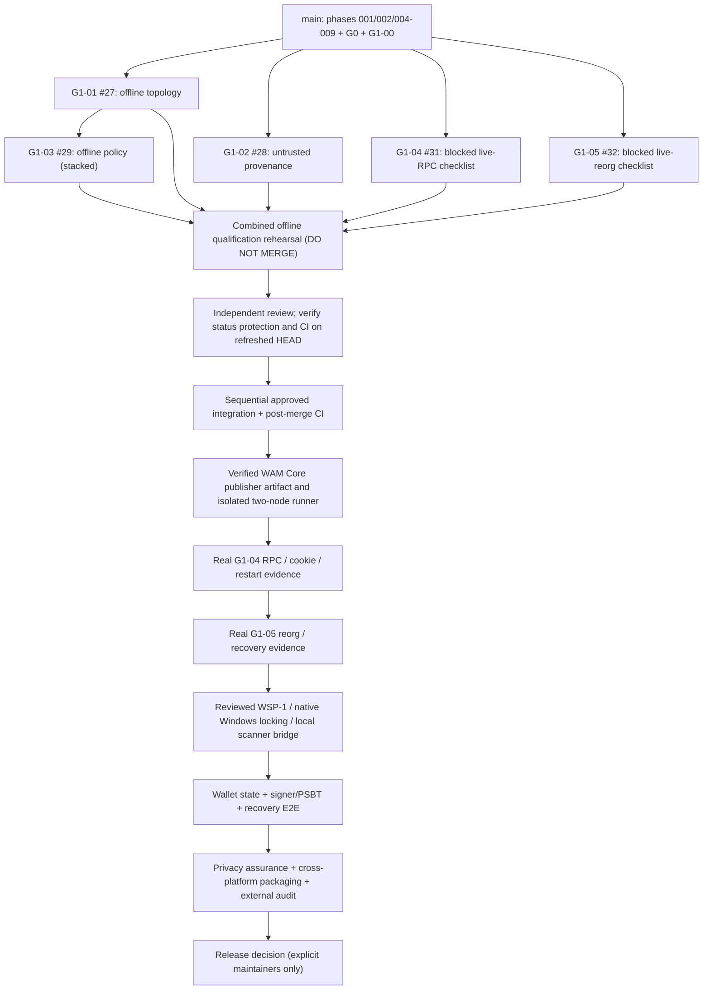

# WAM Privacy Wallet — delivery status & remaining work (2026-10-10)

> **Experimental / NOT production-ready.** Progress here refers to **repository evidence**, not security, real-node or funds qualification. Verified from GitHub `main@862bb7692bca9a6f66f490cf5b6bc1dfb9f69fe5` and review PRs on 2026-10-10.
> This document belongs to a **DO NOT MERGE integration rehearsal**. Its statements about combined testing require an exact-HEAD Actions result, not only the prior individual PR results.

## 1. Delivered and merged (current main)

| Workstream | Verified delivered | Limits / next gates |
| --- | --- | --- |
| Open-source & governance | Public MIT license, contributor/security/release docs (PR #14), Core repo remains independent | Full all-ref/history/log/artifact secret scan, license/supply-chain review and stronger required-PR/checks rules **not verified complete** |
| Wallet foundation | 001 GUI shell; 002 localhost regtest endpoint; 004 identity; 005 bounded read-only RPC; 006 gateway; 007 opt-in one-node local identity diagnostic; 008 Core profile; 009 Core source pin | No operational scanner, wallet balance, signing, recovery, real Core E2E or mainnet authorization |
| G0/CI | CI optimization PR #19; fail-closed suite inventory PR #26; G0-B1..B4 PRs #20–23 | No dropped mandatory test suites, but CI passing is not a security audit |
| G1 foundation | G1-00 local binary checksum preflight PR #24 | Hash match is **not publisher authentication**; no real Core execution by that preflight |

**Current main offline CI:** 8 jobs; 13 mandatory offline suites, baseline **106 cases per OS/architecture**; independent CodeQL Python and Actions jobs. GUI and offline scopes differ: full GUI/crypto on Windows x86 remains unsupported/unqualified.

## 2. Implemented and CI-verified on OPEN DRAFT — not delivered to main

| Stage / PR | Implemented offline scope | PR CI evidence | Integration status |
| --- | --- | --- | --- |
| G1-01 [#27](https://github.com/Urriki1502/wam-privacy-wallet/pull/27) | Two-node loopback *proposal* only | 14 suites / 116 cases + 8 Wallet jobs + 2 CodeQL PASS | Draft; review and then integrate |
| G1-02 [#28](https://github.com/Urriki1502/wam-privacy-wallet/pull/28) | Untrusted binary provenance *metadata intake* | 14/116, 8 Wallet + 2 CodeQL PASS | Draft; **not publisher proof** |
| G1-03 [#29](https://github.com/Urriki1502/wam-privacy-wallet/pull/29) | Strict policy audit for G1-01 candidate | previous head 15/126 PASS; updated hardened head requires fresh 15/129 CI and CodeQL | **Stacked on #27**, must review #27 first |
| G1-04 [#31](https://github.com/Urriki1502/wam-privacy-wallet/pull/31) | Required RPC/auth/cookie/restart negative-case *inventory* | 14/116, 8 Wallet + 2 CodeQL PASS | Draft; **real RPC qualification BLOCKED** |
| G1-05 [#32](https://github.com/Urriki1502/wam-privacy-wallet/pull/32) | Required fork/reorg/restore/scanner/lease *inventory* | 14/116, 8 Wallet + 2 CodeQL PASS | Draft; **real reorg/scanner qualification BLOCKED** |

**This combined rehearsal (new review PR, DO NOT MERGE)** combines the five *non-executing* G1 source/document/test deltas without changing WAM Core, WSP or frozen research. It should qualify **18 mandatory offline suites / 159 cases per architecture** plus three x64 GUI jobs, pinned Core GET-only check and CodeQL **at one exact integrated HEAD**. Individual green checks do not prove combined green until the run is inspected.

## 3. Critical unfinished dependencies / priority

| Priority | Work / owner evidence | Gate to unblock |
| --- | --- | --- |
| P0-A | Native scanner writer lease on Windows x86/x64 and crash/reacquire: [wallet issue #4](https://github.com/Urriki1502/wam-privacy-wallet/issues/4), [upstream PR #9](https://github.com/Urriki1502/wam-silent-payments/pull/9) | Independent review of actual cross-process OS locks, no no-op substitutes, WSP maintainer decision |
| P0-B | WSP-1 provenance/API [Draft #3](https://github.com/Urriki1502/wam-privacy-wallet/pull/3); local-only scanner read shape [Draft #16](https://github.com/Urriki1502/wam-privacy-wallet/pull/16) | Resolve RPC 1.0/2.0 mismatch, fresh attestation, locking, bounded getblock/mempool and negative cases; explicit upstream review |
| P0-C | Real WAM Core regtest [issue #9](https://github.com/Urriki1502/wam-privacy-wallet/issues/9) | Independently authenticated publisher artifact + SHA, isolated reviewed two-node runner, cookie/restart/RPC/reorg evidence; never substitute mock PASS |
| P0-D | Scanner real integration, storage journal/rollback, recovery/reorg, signer/consent/PSBTv2 | Implement independent scan and spend privileges, backup/restore and adversarial proofs **after** prerequisite reviews |
| P1-A | 32-bit GUI+crypto [issue #5](https://github.com/Urriki1502/wam-privacy-wallet/issues/5) | Actual native wheels and GUI package qualification; Python 32-bit offline test green alone is not enough |
| P1-B | GitHub governance + supply chain | Required PR/checks enforcement, all-history secret audit, SBOM/licenses, code signing and provenance validation |
| P1-C | Privacy features (PayJoin / disclosure / peer-route exposure) | Explicit consent, first-hop threat review, no hidden hosted scanner, privacy negative tests |
| P1-D | Production assurance & operator release | Independent audit, E2E with test fixtures, verified testnet operation, signed reproducible builds, secure update and support/rollback docs |

Do **not** infer a percentage of production completeness from PR count. A code scaffold and a production wallet have unequal risk and effort. There are no real-funds qualifications evidenced in the above history.

## 4. Safe integration order and dependency graph

**Maintain strict review boundaries:** WSP-1 [Draft #3](https://github.com/Urriki1502/wam-privacy-wallet/pull/3), Phase 010 [Draft #16](https://github.com/Urriki1502/wam-privacy-wallet/pull/16), G0/G1 previous no-merge rehearsal [#25](https://github.com/Urriki1502/wam-privacy-wallet/pull/25), and upstream WSP lock PR #9 remain separate. Do not alter or auto-merge any of them.

## 5. Verification and handoff checklist

1. Confirm combined source blobs match individually reviewed PR HEADs exactly; do not copy their original divergent `wallet-ci.yml`, only register all 5 new test modules in the existing fail-closed runner.
2. Run 18/18 mandatory suites and at least 159 collected cases **on each of Windows x86, Windows x64, macOS x64 and Linux x64**; do not hide failed, skipped or missing suites.
3. Confirm full GUI discovery Linux/macOS/Windows x64, pinned Core GET-only source check, and CodeQL Python/Actions 2/2 on exact integrated HEAD.
4. Compare integration end-to-end wall-clock with the preceding clean main runs; distinguish elapsed time from billable runner-minutes.
5. **Do not merge this rehearsal.** Perform code/architecture/security review of individual Draft PRs; then, with explicit approval, integrate in dependency order with refreshed gate counts on `main` after each merge.
6. After real Core provenance and reviewed execution environment are available, create separate *manual* real-node qualification jobs with honest **BLOCKED** semantics when prerequisites are missing.

## Strict-schema G1-03 update

G1-03 SHA `adb3d74aef553b2e2e841f6ae8f0ca7c9598a5c0` includes 3 additional regression cases to block `False == 0 == 0.0`, numeric-equivalent peer ports and string-subclass coercion. Combined acceptance grows from 18/156 to **18/159**. Historical green runs on old SHA must never qualify the refreshed HEAD. Real Core verification remains BLOCKED.
